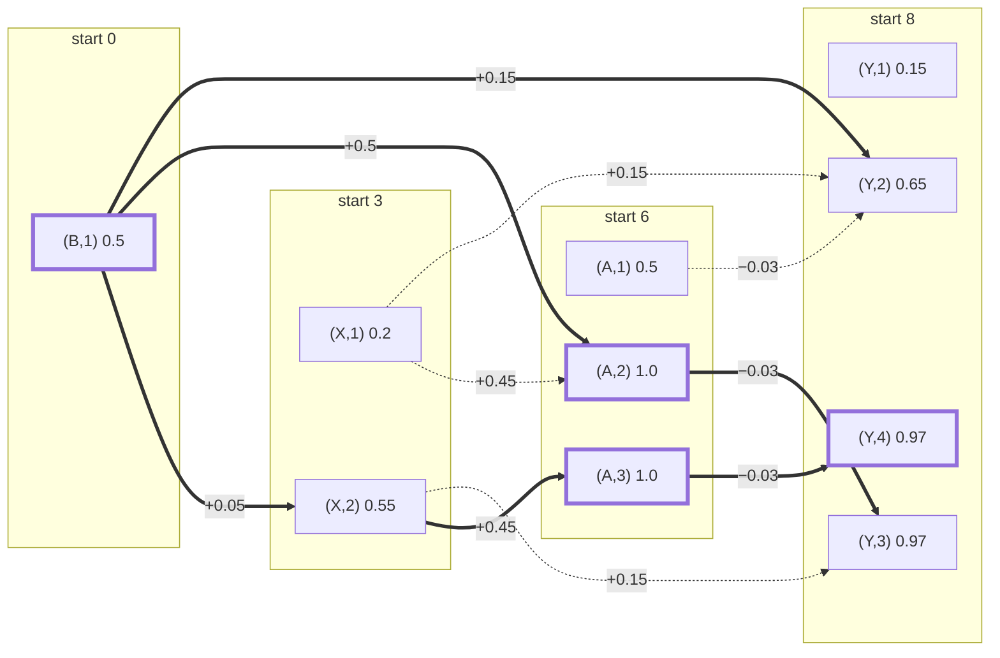

# How the chain DP in `run_modified_smith_waterman_composite()` works

A walkthrough of `_chain_composite` (`composite.py`), which finds the best chain of subunit matches on the target for every number of matches.

## 0. Definitions

**Sizes and positions**

| Symbol | Definition |
|---|---|
| L | length of the target motif |
| M | length of the subunit stack: every subunit, padded to a common length, before trimming |
| F | number of subunits in the stack |
| candidate | one trimmed subunit in one orientation (forward or reverse complement) |
| C | number of candidates: 2F with `allow_reverse_comp` (the default), F without |
| c | a candidate index, 0 … C−1 |
| M_c | length of candidate c after `subunit_motif_trim` |
| padded target | the target with M−1 zero rows added on each side, so a candidate may overhang either end; L2-normalized to total energy 1 |
| S | length of the padded target, L + 2M − 2 (also the number of possible starts) |
| l | the start of a candidate: the padded position of its first column |
| t | the end of a candidate: t = l + M_c, one past its last column, so it covers [l, t) |
| e | the end of a chain: the end t of the chain's last candidate |
| [a, b) | padded positions a, a+1, …, b−1 |

**Inputs to `_chain_composite`**

| Variable | Shape | Definition |
|---|---|---|
| `match_scores` | (C, S) | m: the match score of candidate c at start l, the window energy × the similarity |
| window energy | — | sum of squares of the padded target over [l, t) |
| similarity | — | cosine of candidate c with the target window [l, t) (8-channel signed by default) |
| `matchable` | (C, S) bool | candidate c may match at l: the window fits inside the padded target and the similarity > `sim_threshold` |
| `cand_len` | (C,) | M_c for each candidate |
| `overlap_penalty_fraction` | scalar | λ: the fraction of the overlapping energy charged as a penalty |
| `overlap_weight` | (S,) | the target energy at each padded position (sums to 1) |
| `max_count` | int or None | `match_count_max`: the most matches allowed (None: no limit) |

**Pairs and counts**

| Variable | Shape | Definition |
|---|---|---|
| pair | — | a matchable (candidate, start) combination |
| K | scalar | number of pairs, over all starts |
| k | — | a pair index, 0 … K−1, ordered by start, then by candidate |
| `pairs_c`, `pairs_l` | (K,) | the candidate and the start of each pair |
| `ends` (t_k) | (K,) | the end of each pair, `pairs_l + cand_len[pairs_c]` |
| m_k | — | the match score of pair k |
| `starts` | (≤ S,) | the distinct starts that have at least one pair |
| `ks` | (K_l,) | the pairs at the current start l (K_l of them) |
| chain | — | a sequence of pairs with strictly increasing starts |
| n | — | the number of matches (pairs) in a chain, 0 … `num_n` |
| `num_n` | scalar | the most matches considered: the number of distinct starts, capped by `max_count` |
| N | scalar | the number of matches finally selected by `_select_match_count` |

**Energy and working tables**

| Variable | Shape | Definition |
|---|---|---|
| P | scalar | number of end positions tracked: S + 1 + max(M_c) |
| `weight[x]` | (P,) | `overlap_weight[x]`, and 0 past the padded target |
| `W[x]` | (P+1,) | cumulative energy: weight[0] + … + weight[x−1], the energy of all positions before x (W[0] = 0) |
| `value[k, n]` | (K, num_n+1) | best score of an n-chain whose last pair is k (−∞: impossible) |
| `previous[k, n]` | (K, num_n+1) | the pair before k in that chain (−1: none) |
| `best[e, n]` | (P, num_n+1) | best score so far of an n-chain ending at e (−∞: none) |
| `best_pair[e, n]` | (P, num_n+1) | the last pair of that chain (−1: none) |
| `prior` | (P,) | `best[:, n−1]`, the (n−1)-chains a pair at l can extend |
| e\* | — | the end of the (n−1)-chain a pair extends in its best n-chain |

**Outputs**

| Variable | Shape | Definition |
|---|---|---|
| `msw_profile[n]` | (num_n+1,) | best score of any n-chain (`msw_profile[0] = 0`, the empty alignment; −∞: impossible) |
| `found[n]` | — | the last pair of that best n-chain |
| `trace(n)` | — | that chain, as (candidate, start) pairs, left to right |
| `msw_score` | scalar | `msw_profile[N] − match_count_penalty · N` |

---

## 1. The goal

For every n = 0, 1, …, num_n, find the exact best score of a chain of exactly n candidates with strictly increasing starts, and the chain itself, where

```
score = Σ match scores − λ · Σ (energy of each overlap between consecutive candidates)
```

Only positions on the target matter: the order of the subunits in the stack just decides their indices.

---

## 2. Theoretical basis

### 2a. The chain score

A chain of n matches is a sequence of pairs with strictly increasing starts:

$$
(k_1, k_2, \ldots, k_n), \qquad l_{k_1} < l_{k_2} < \cdots < l_{k_n}.
$$

The overlap cost of a pair at $[l, t)$ that follows a chain ending at $e$ is

$$
c(e;\, l, t) =
\begin{cases}
0, & e \le l \quad \text{(no overlap)} \\[2pt]
\lambda \left( W[e] - W[l] \right), & l < e \le t \quad \text{(partial overlap)} \\[2pt]
\lambda \left( W[t] - W[l] \right), & e > t \quad \text{(the pair is covered)}
\end{cases}
$$

that is, $\lambda$ times the target energy on $[l, \min(e, t))$. The score of a chain is the sum of its match scores minus the cost of each consecutive overlap:

$$
\operatorname{score}(k_1, \ldots, k_n) = \sum_{i=1}^{n} m_{k_i} \;-\; \sum_{i=2}^{n} c\!\left(t_{k_{i-1}};\, l_{k_i}, t_{k_i}\right).
$$

The goal (section 1) is, for every $n$,

$$
\texttt{msw\_profile}[n] = \max_{\text{chains of } n \text{ matches}} \operatorname{score}(k_1, \ldots, k_n), \qquad \texttt{msw\_profile}[0] = 0.
$$

### 2b. A longest path in a DAG

Define a graph:

- **Nodes** $(k, n)$, for each pair $k$ and each count $n = 1, \ldots, \texttt{num\_n}$. The node means "pair $k$ is the last match of a chain of $n$ matches". The same pair appears once per count. Each node is one cell `value[k, n]`.
- **Edges** $(k', n-1) \to (k, n)$ whenever $l_{k'} < l_k$, meaning "append pair $k$ to an $(n-1)$-chain ending at $k'$". The edge weight is the gain of that step:

$$
w\big((k', n-1) \to (k, n)\big) = m_k - c\!\left(t_{k'};\, l_k, t_k\right).
$$

- **Start nodes** $(k, 1)$, with weight $m_k$.

Every edge goes to a strictly later start, so the graph has no cycles. A path from a start node to $(k, n)$ visits exactly $n$ nodes, and its total weight is the score of the matching $n$-chain ending at $k$. So the best $n$-chain is a longest path in this DAG.

### 2c. Topological order

**Why a DAG is easy.** In a general graph, a longest path is hard to find: a node's best value can depend on nodes that haven't been settled yet. In a DAG the nodes can be put in a *topological order*, where every edge points from an earlier node to a later one. Visiting the nodes in that order, each node's value is

$$
V(\text{node}) = w(\text{node}) + \max_{\text{edges } p \to \text{node}} \Big[ V(p) + w(p \to \text{node}) \Big],
$$

and every predecessor $p$ is already final when it's read, because it comes earlier in the order. One pass gives the exact answer.

**The topological order here is the sort by start.** Every edge $(k', n-1) \to (k, n)$ has $l_{k'} < l_k$, so any order in which starts increase is topological. Step 3 lists the pairs by start, and the sweep (step 7) visits the starts left to right. That is the topological sort; nothing else is sorted.

- Pairs at the same start have no edges between them (starts must strictly increase), so their order doesn't matter, and the code scores them together.
- Holding back the insertion into `best` until every pair at $l$ is scored (step 7c) is what stops a pair from using another pair at the same start as its predecessor.
- The graph is never built. The edges into a pair at $l$ are implicit (every earlier pair), and the max over all of them is taken at once through `best` and the three running maxima (2e, 2f).

Section 2i runs the whole DP, sweep, `best` table and backpointers included, on a four-pair example.

### 2d. The Bellman recurrence

Let $V(k, n)$ be the best score of an $n$-chain ending with pair $k$ (`value[k, n]`). Then

$$
V(k, 1) = m_k,
$$

$$
V(k, n) = m_k + \max_{k' \,:\, l_{k'} < l_k} \Big[ V(k', n-1) - c\!\left(t_{k'};\, l_k, t_k\right) \Big], \qquad n \ge 2,
$$

with the max over an empty set equal to $-\infty$. The profile is the best over the last pair:

$$
\texttt{msw\_profile}[n] = \max_{k} V(k, n).
$$

**Why this is exact (optimal substructure).** Let $(k_1, \ldots, k_{n-1}, k)$ be the best $n$-chain ending at $k$. The last term $c(t_{k_{n-1}}; l_k, t_k)$ depends on the prefix only through $k_{n-1}$. If some other $(n-1)$-chain ending at $k_{n-1}$ scored higher than $(k_1, \ldots, k_{n-1})$, swapping it in would raise the total. So the prefix is itself the best $(n-1)$-chain ending at $k_{n-1}$, with score $V(k_{n-1}, n-1)$.

### 2e. Grouping predecessors by their end

The cost $c(t_{k'}; l, t)$ depends on the predecessor $k'$ only through its end $e = t_{k'}$, not through its subunit, orientation or start. So predecessors that share an end can be merged into one value, the best of them:

$$
B_l(e, n) = \max_{k' \,:\, l_{k'} < l,\; t_{k'} = e} V(k', n) \qquad (\texttt{best}[e, n] \text{ when the sweep is at start } l).
$$

The recurrence then runs over ends instead of pairs:

$$
V(k, n) = m_k + \max_{e} \Big[ B_{l_k}(e, n-1) - c(e;\, l_k, t_k) \Big].
$$

Merging is valid because two predecessors with the same end look the same to every possible successor. The lower-scoring one can never be part of an optimal chain, so $(e, n)$ is a sufficient state: it summarizes everything about a chain's past that its future depends on.

This relies on charging only consecutive overlaps. If overlaps with all earlier pairs were charged, the end of the last pair wouldn't be enough to price the next overlap, and the state would have to describe more of the chain's coverage.

### 2f. The three cases as running maxima

Substituting the three branches of $c$ splits the max over $e$ into three ranges. Writing $B = B_{l}(\cdot, n-1)$, $l = l_k$ and $t = t_k$:

$$
\max_e \big[ B(e) - c(e; l, t) \big] = \max \left\{
\underbrace{\max_{e \le l} B(e)}_{\text{case 1}},\;
\underbrace{\lambda W[l] + \max_{l < e \le t} \big( B(e) - \lambda W[e] \big)}_{\text{case 2}},\;
\underbrace{\max_{e > t} B(e) - \lambda \left( W[t] - W[l] \right)}_{\text{case 3}}
\right\}.
$$

Each inner max is a running maximum over $e$: a prefix max read at $l$, a running max starting at $l+1$ read at $t$, and a suffix max read past $t$. All pairs at the same start share the three arrays, whatever their lengths (step 7b).

### 2g. Updating B start by start

$B_l$ covers the pairs that start before $l$. Let $l^{+}$ be the next distinct start after $l$. Moving from $l$ to $l^{+}$ only adds the pairs at $l$:

$$
B_{l^{+}}(e, n) = \max\Big( B_l(e, n),\; \max_{k \,:\, l_k = l,\; t_k = e} V(k, n) \Big).
$$

This is the insertion in step 7c. It happens only after every pair at $l$ is scored, so pairs at the same start never see each other, which enforces $l_{k'} < l_k$.

### 2h. Backpointers and the trace

Let $A_l(e, n)$ be the pair attaining $B_l(e, n)$ (`best_pair[e, n]`), and let $e^{*}$ be the end attaining the max in 2e (or 2f). The backpointer of node $(k, n)$ is

$$
\pi(k, n) = A_{l_k}\!\left(e^{*}, n-1\right) \qquad (\texttt{previous}[k, n]).
$$

It must be read while the sweep is at $l_k$. $A$ keeps changing as $l$ grows, so a later $A(e^{*}, n-1)$ may be a pair that starts at or after $l_k$, which $k$ can't follow.

The best $n$-chain is recovered by following the backpointers from the best last pair (section 9):

$$
k_n = \arg\max_k V(k, n), \qquad k_{i-1} = \pi(k_i, i), \quad i = n, n-1, \ldots, 2.
$$

The backpointers take $O(K \cdot \texttt{num\_n})$ memory, against $O(K \cdot \texttt{num\_n}^2)$ for storing every node's chain, and the trace takes $O(n)$ steps.

### 2i. The chain DP on an example

Four pairs on a 12-bp target, with $\lambda = 1$. Each pair is one candidate at one start; the per-position target energy (summing to 1) is on the second line.

**(a) The pairs on the target**

```
position    0    1    2    3    4    5    6    7    8    9    10   11   12
energy      .15  .10  .10  .05  .05  .05  .05  .09  .09  .09  .09  .09

B  m=0.50   [━━━━━━━━━━━━━━━━━━━━━━━━━━━━)                                 [0, 6)
X  m=0.20                  [━━━━━━━━━━━━━━━━━━)                            [3, 7)
A  m=0.50                                 [━━━━━━━━━━━━━━━━━━━━━━━━━━━━)   [6, 12)
Y  m=0.15                                           [━━━━━━━━)             [8, 10)
```

The overlaps that matter: X overlaps B on $[3, 6)$ (energy 0.15), A overlaps X on $[6, 7)$ (0.05), and Y lies inside A on $[8, 10)$ (0.18). B and A touch but don't overlap.

**(b) The DAG.** Columns are starts, in topological order. Each node $(k, n)$ shows its value $V(k, n)$, and each edge its weight $m_k - c$. Every edge the recurrence considers is drawn. **Thick** edges are the winning predecessors, i.e. the backpointers `previous[k, n]`, and the nodes with a thick border are `found[n]`, the best last pair for each $n$. The nodes $(B, 2..4)$, $(X, 3..4)$ and $(A, 4)$ have no incoming edges (too few earlier starts), so they are $-\infty$ and left out.



A textbook longest-path pass would evaluate these 10 edges one by one. The chain DP never does: it evaluates the edges into a start all at once through `best` (panel c) and the three running maxima (the table below).

**(c) `best[e, n]` (`best_pair`), as read by the pairs at each start.** Only the ends that are ever filled are shown; `·` is $-\infty$. The pairs at a start read the table *before* they are inserted (step 7c), so they never see each other.

```
                           e = 6      e = 7      e = 10     e = 12
read at start 3 (by X)
  n = 1                    0.5  B     ·          ·          ·
read at start 6 (by A)
  n = 1                    0.5  B     0.2  X     ·          ·
  n = 2                    ·          0.55 X     ·          ·
read at start 8 (by Y)
  n = 1                    0.5  B     0.2  X     ·          0.5  A
  n = 2                    ·          0.55 X     ·          1.0  A
  n = 3                    ·          ·          ·          1.0  A
after the sweep
  n = 1                    0.5  B     0.2  X     0.15 Y     0.5  A
  n = 2                    ·          0.55 X     0.65 Y     1.0  A
  n = 3                    ·          ·          0.97 Y     1.0  A
  n = 4                    ·          ·          0.97 Y     ·
```

**The lookups.** For $n = 1$, $V(k, 1) = m_k$. For $n \ge 2$, each pair at $[l, t)$ reads `best[:, n−1]` in the three ranges of 2f; the winning case gives both the value and the backpointer. Overlap energies are $W[6] - W[3] = 0.15$, $W[7] - W[6] = 0.05$ and $W[10] - W[8] = 0.18$.

| start | pair $[l, t)$ | $n$ | case 1: $e \le l$ | case 2: $l < e \le t$ | case 3: $e > t$ | `value[k, n]` | `previous[k, n]` |
|---|---|---|---|---|---|---|---|
| 3 | X $[3, 7)$ | 2 | · | best[6,1] − 0.15 = 0.35 | · | 0.2 + 0.35 = **0.55** | B |
| 6 | A $[6, 12)$ | 2 | best[6,1] = **0.5** | best[7,1] − 0.05 = 0.15 | · | 0.5 + 0.5 = **1.0** | B |
| 6 | A $[6, 12)$ | 3 | · | best[7,2] − 0.05 = **0.5** | · | 0.5 + 0.5 = **1.0** | X |
| 8 | Y $[8, 10)$ | 2 | max(best[6,1], best[7,1]) = **0.5** | · | best[12,1] − 0.18 = 0.32 | 0.15 + 0.5 = **0.65** | B |
| 8 | Y $[8, 10)$ | 3 | best[7,2] = 0.55 | · | best[12,2] − 0.18 = **0.82** | 0.15 + 0.82 = **0.97** | A |
| 8 | Y $[8, 10)$ | 4 | · | · | best[12,3] − 0.18 = **0.82** | 0.15 + 0.82 = **0.97** | A |

Two things the table shows that the DAG hides:

- **Grouping by end.** For $(Y, 2)$, the edges from $(B, 1)$ and $(X, 1)$ are both case 1. The DP doesn't compare them: one prefix maximum over $e \le 8$ covers both ends, 6 and 7.
- **Reading the backpointer at once.** `previous[Y, 3]` is `best_pair[12, 2]` = A, read at start 8. Here nothing later overwrites `best_pair[12, 2]`, but in general a later start could, which is why it's saved now (2h).

**The result.** The profile is the best value in each row of the DAG:

$$
\texttt{msw\_profile} = [\,0,\; 0.5,\; 1.0,\; 1.0,\; 0.97\,], \qquad \texttt{found} = [\,\cdot,\; B,\; A,\; A,\; Y\,].
$$

Following the backpointers from `found[n]` gives the best chain for each $n$:

| $n$ | trace | score |
|---|---|---|
| 1 | B | 0.5 |
| 2 | B → A | 0.5 + 0.5 = 1.0 |
| 3 | B → X → A | 0.5 + 0.2 + 0.5 − 0.15 − 0.05 = 1.0 |
| 4 | B → X → A → Y | 1.0 + 0.15 − 0.18 = 0.97 |

With the default `match_count_penalty = 0` and `match_count_fraction = 1`, `_select_match_count` picks the smallest $N$ reaching the best score, $N = 2$: B and A. Y is never worth adding: it is covered by A, so it is charged its whole window's energy (0.18) but only earns its match score (0.15, a similarity of 0.83), so its edges from A are negative. These are the values `_chain_composite` returns on this input, and a brute-force search over every chain gives the same profile.

### 2j. How the theory maps onto the tables

| Theory | Table |
|---|---|
| $V(k, n)$, value of a node | `value[k, n]` (derivable from `best`, hence redundant) |
| $\pi(k, n)$, backpointer of a node | `previous[k, n]` (needed) |
| $B_l(e, n)$, best value per state (end, n) over pairs before $l$ | `best[e, n]` (needed) |
| $A_l(e, n)$, the pair attaining $B_l(e, n)$ | `best_pair[e, n]` (needed) |

---

## 3. List the matchable (candidate, start) pairs, sorted by start

```python
pairs_c, pairs_l = np.nonzero(matchable.T)[::-1]
```

This lists every matchable pair as (candidate index, start), sorted by start l and then by candidate. Each pair gets an index k = 0 … K−1, and its end is

```python
ends = pairs_l + cand_len[pairs_c]   # t = l + M_c, just past the candidate's last column
```

`starts` holds the distinct starts that have at least one pair. This sort by start is the topological order of section 2c.

---

## 4. Bound the number of matches

```python
num_n = len(starts) if max_count is None else min(len(starts), max_count)
```

Starts must strictly increase, so a chain can't have more matches than there are distinct starts. `match_count_max` caps it further. Every array below has an n axis of length num_n + 1, for n = 0 … num_n.

---

## 5. Precompute the cumulative energy W

```
weight[x] = target energy at padded position x   (0 past the end)
W[x]      = weight[0] + … + weight[x−1]          (energy of all positions before x)
```

The energy of any span [a, b) is then W[b] − W[a] in O(1). An overlap between a chain ending at e and a new candidate at [l, t) covers [l, min(e, t)), so

```
overlap cost = λ · (W[min(e, t)] − W[l])   if e > l, else 0
```

---

## 6. The working tables

| Table | Shape | Holds |
|---|---|---|
| `value[k, n]` | (K, num_n+1) | best score of a chain of exactly n candidates whose **last** candidate is pair k |
| `previous[k, n]` | (K, num_n+1) | the pair just before k in that best chain (−1 if none) |
| `best[e, n]` | (P, num_n+1) | best score so far of any n-chain whose last candidate **ends** at position e |
| `best_pair[e, n]` | (P, num_n+1) | which pair k achieved `best[e, n]` |

Everything starts at −∞ (impossible), and the pointers at −1.

`best` is indexed by **end position**, not by subunit: a future candidate only needs to know where the previous one ended, so keeping one best chain per (end, n) loses nothing (section 2e).

---

## 7. Sweep the starts, left to right

For each distinct start l in increasing order, take every pair k that starts at l. Call them `ks`; there can be many, one per candidate matchable there.

### 7a. Chains of length 1

```
value[k, 1] = m_k
```

A chain of one has no predecessor and no overlap cost.

### 7b. Chains of length n ≥ 2

For each n from 2 to num_n, extend the best (n−1)-chain. Let `prior = best[:, n−1]`, the best (n−1)-chains by end e. At this point `best` only contains chains whose last start is before l, because candidates at l haven't been inserted yet (step 7c). That alone enforces strictly increasing starts.

For a candidate at [l, t), the previous chain's end e falls into one of three cases.

**Case 1: e ≤ l, no overlap.** The previous chain ended before or exactly at the start of this candidate.

```
contribution = max over e ≤ l of prior[e]
```

This is computed with a running maximum over `prior` (`_first_running_max`), read at l. The value is the same for every candidate at this start.

**Case 2: l < e ≤ t, partial overlap.** The previous chain ends inside the new candidate, so they overlap on [l, e), which costs λ(W[e] − W[l]):

```
contribution = max over l < e ≤ t of (prior[e] − λ·W[e]) + λ·W[l]
```

Moving W[e] inside the max turns it into one running maximum of `prior[e] − λ·W[e]`, starting at e = l+1. Each candidate reads it at its own t, so candidates of different lengths are all handled by the same array.

**Case 3: e > t, the previous chain covers the new candidate.** The previous chain ends past the new candidate's end, so the overlap is the whole candidate, [l, t), with cost λ(W[t] − W[l]):

```
contribution = max over e > t of prior[e] − λ·(W[t] − W[l])
```

This is a running maximum from the right (a suffix maximum), read just past t.

Then for each candidate:

```
value[k, n]    = m_k + max(case 1, case 2, case 3)
previous[k, n] = best_pair[e*, n−1]
```

Here e\* is the end that gave the winning case. `_first_running_max` returns the position of each maximum along with its value, so e\* is known. Ties go to case 1, then 2, then 3, i.e. to less overlap. If all three cases are −∞ (no (n−1)-chain to extend), `value[k, n]` stays −∞.

**Why the pointer is stored now.** `best_pair[e*, n−1]` can later be overwritten by a chain that starts at or after l, which this candidate couldn't follow, so `previous[k, n]` records the predecessor now (section 2h).

### 7c. Insert the candidates at l into `best`

Only after every candidate at start l has been scored, for each pair k at l and each n:

```
if value[k, n] > best[t_k, n]:
    best[t_k, n], best_pair[t_k, n] = value[k, n], k
```

Two candidates at the same start can't chain with each other, because neither is visible yet while they're being scored. Candidates at later starts will see them. Ties go to the earlier pair.

---

## 8. Read off the best chain for each count

After the sweep:

```
msw_profile[0] = 0      (the empty alignment)
for n in 1..num_n:
    found[n] = argmax over k of value[k, n]
    msw_profile[n] = value[found[n], n]      (−inf if no n-chain exists)
```

Every n-chain ends with some pair k, so the best over all k is the exact best n-chain.

---

## 9. Trace back

`trace(n)` starts at k = found[n] and follows the pointers:

```
chain = []
while n > 0:
    chain.append((pairs_c[k], pairs_l[k]))
    k, n = previous[k, n], n − 1
return chain reversed       (left to right)
```

The result is a list of (candidate, start) pairs.

---

## 10. Back in the wrapper

1. `_select_match_count` picks N from `msw_profile`: the smallest N whose `msw_profile[N] − match_count_penalty·N` reaches `match_count_fraction` × the best such value.
2. `matches = trace(N)`, and `msw_score = msw_profile[N] − match_count_penalty·N`.
3. Each matched candidate maps back to its subunit index and orientation (`cand_subunit`, `cand_rc`) and is placed at its start, scaled by its projection ‖target window‖ · similarity.
4. `sim_score` is the similarity between the sum of the placed subunits and the target.

---

## 11. Worked example: target = B + A, stack = [A, B]

Suppose B (6 bp) sits at target positions 0–5 and A (6 bp) at 6–11. Ignore padding offsets and reverse complements for clarity, and say both match perfectly, each holding half the energy (m = 0.5).

Matchable pairs, sorted by start: (B, 0) as k = 0 with t = 6, and (A, 6) as k = 1 with t = 12.

**Start 0, pair k = 0 (B):**
- value[0, 1] = 0.5.
- n = 2: `best[:, 1]` is still all −∞, so value[0, 2] = −∞.
- Insert: best[6, 1] = 0.5, best_pair[6, 1] = 0.

**Start 6, pair k = 1 (A):**
- value[1, 1] = 0.5.
- n = 2, with prior = best[:, 1]:
  - Case 1 (e ≤ 6): the maximum is best[6, 1] = 0.5, at e\* = 6.
  - Case 2 (6 < e ≤ 12): nothing there, −∞.
  - Case 3 (e > 12): −∞.
  - So value[1, 2] = 0.5 + 0.5 = 1.0, and previous[1, 2] = best_pair[6, 1] = 0 (B).
- Insert: best[12, 1] = 0.5 and best[12, 2] = 1.0.

**Profile:** [0, 0.5, 1.0]. With the defaults (penalty 0, fraction 1), N = 2.

**Trace(2):** k = 1 (A at 6), then previous[1, 2] = 0 (B at 0), reversed to [B at 0, A at 6].

The input order [A, B] never came into it: B was found first only because it starts first on the target.

**With an overlap.** Suppose A instead started at 4, overlapping B on positions 4–5, which hold energy 0.1. Then B's end e = 6 falls in case 2 (4 < 6 ≤ 10), and

```
value = 0.5 + 0.5 − λ·(W[6] − W[4]) = 1.0 − 0.1 = 0.9   (λ = 1)
```

The two together are credited with the energy they cover, not 0.1 twice.

---

## 12. Why it's exact

The proof is in section 2: the sweep is the Bellman recurrence over a DAG in topological order (2c, 2d), predecessors are merged by end without loss (2e), and each of the three cases is an exact running maximum (2f). Brute-force enumeration of every possible chain on small random cases (section j of `tests/test_composite_msw.py`) agrees to within 1e-12.

One simplification is built into the scoring rule itself: only **consecutive** overlaps are charged. If a long candidate covers the next two, the third's overlap with the first isn't charged, because the state only remembers the last candidate's end.

---

## 13. Cost

- For each distinct start and each n: a few vectorized running maxima over the P end positions, so about O(S · P · num_n) ≈ O(S² · num_n) array work.
- Plus inserting each pair once per n: O(K · num_n), in a small Python loop.
- There's no per-cell Python loop over a (stack × position) grid, and no orientation passes, since reverse complements are just more candidates. On the 1487-reference stack that came to about 0.07 s per motif.